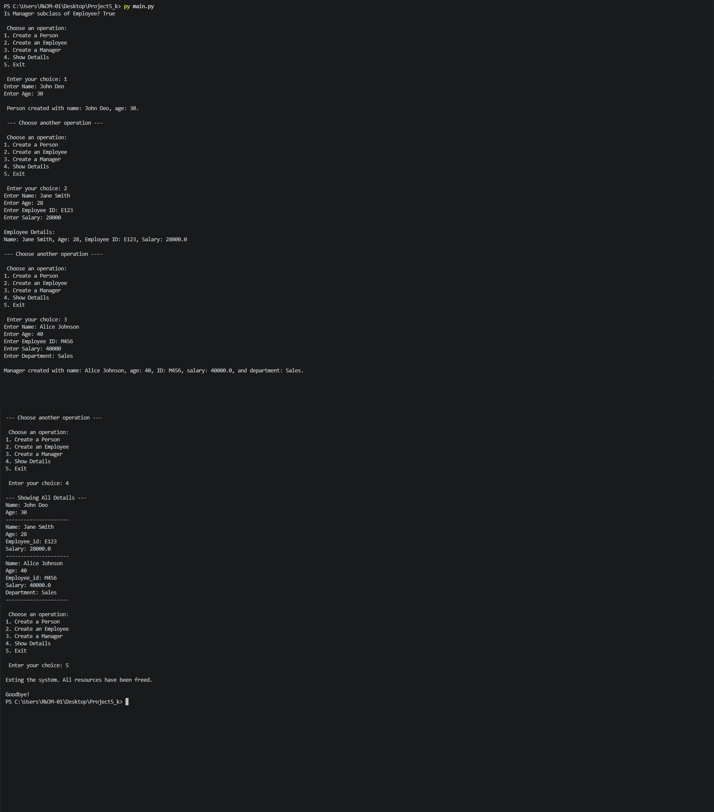

# 🧩 Project 5: OOP Wrapper – Employee Management System

---

## 📖 Project Description

**OOP Wrapper** is a menu-driven, command-line Python application that demonstrates the core concepts of **Object-Oriented Programming (OOP)**. It models a simple organization hierarchy using three classes: `Person`, `Employee`, and `Manager`.

Users can create people, employees, and managers at runtime, store them in a single list, and display the details of every object through a common `display()` method.

---

## ✨ Features

- 👤 **Create a Person** with name and age
- 💼 **Create an Employee** with name, age, employee ID, and salary
- 🧑‍💼 **Create a Manager** with all employee details plus a department
- 📋 **Show Details** of all created objects in one go
- 🔒 **Encapsulation** – private attributes (`__employee_id`, `__salary`) accessed through getters and setters
- 🧬 **Inheritance** – `Manager` → `Employee` → `Person`, verified with `issubclass()`
- 🔁 **Polymorphism** – each class overrides `display()` with its own behavior
- 🛡️ **Validation** – negative salaries are rejected in `set_salary()`
- 🗑️ **Destructor** support for cleanup messages
- 🔄 **Interactive menu loop** that runs until the user chooses to exit

---

## 🛠️ Technologies Used

| Technology | Purpose |
|------------|---------|
| 🐍 **Python 3** | Core programming language |
| 🧱 **OOP Concepts** | Classes, inheritance, encapsulation, polymorphism |
| 💻 **Command Line (CLI)** | User interaction via `input()` and `print()` |
| 🆚 **Visual Studio Code** | Code editor used for development |
| 🌿 **Git** | Version control |
| 🐙 **GitHub** | Hosting the repository and sharing the project |

---

## 🚀 How to Run

1. **Make sure Python 3 is installed**
   ```bash
   python --version
   ```

2. **Clone or download the project**
   ```bash
   git clone <your-repository-url>
   cd <project-folder>
   ```

3. **Run the program**
   ```bash
   python main.py
   ```


4. **Follow the on-screen menu**
   ```
   Choose an operation:
   1. Create a Person
   2. Create an Employee
   3. Create a Manager
   4. Show Details
   5. Exit
   ```

---

## 📂 Project Structure  

```
 ├── 📄 main.py 
 ├── 📄 output.png    
 └── 📄 README.md    
```

### 🏗️ Class Hierarchy

```
Person
  └── Employee
        └── Manager
```

| Class | Inherits From | Key Attributes |
|-------|---------------|----------------|
| `Person` | – | `name`, `age` |
| `Employee` | `Person` | `__employee_id`, `__salary` (private) |
| `Manager` | `Employee` | `department` |

---

## 🖥️ Output


---

## 👩‍💻 Author

**Kajal**

---


